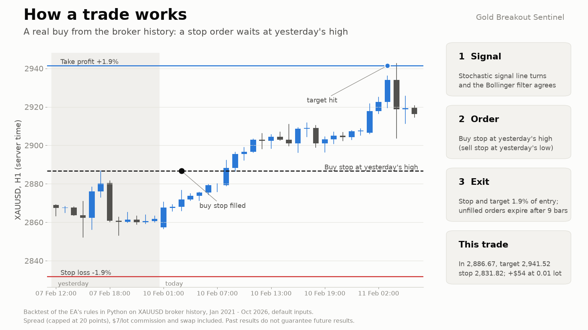
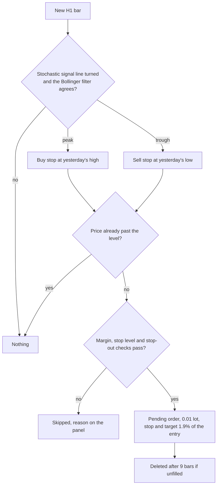
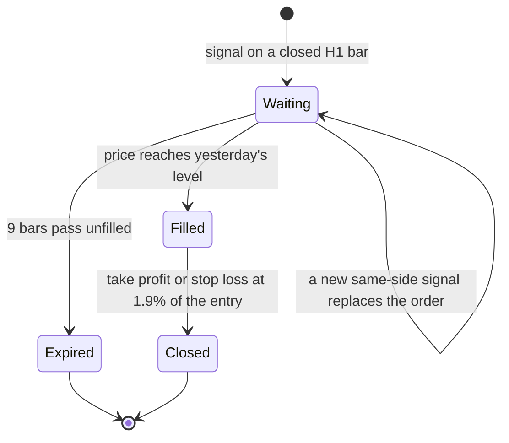
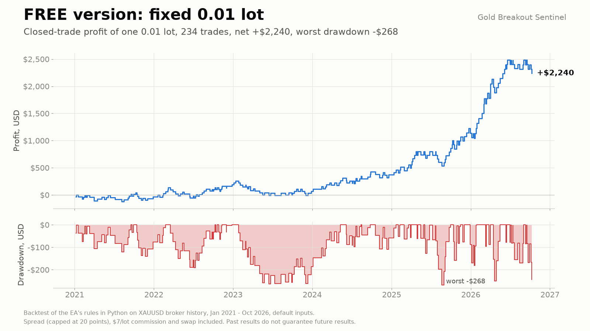
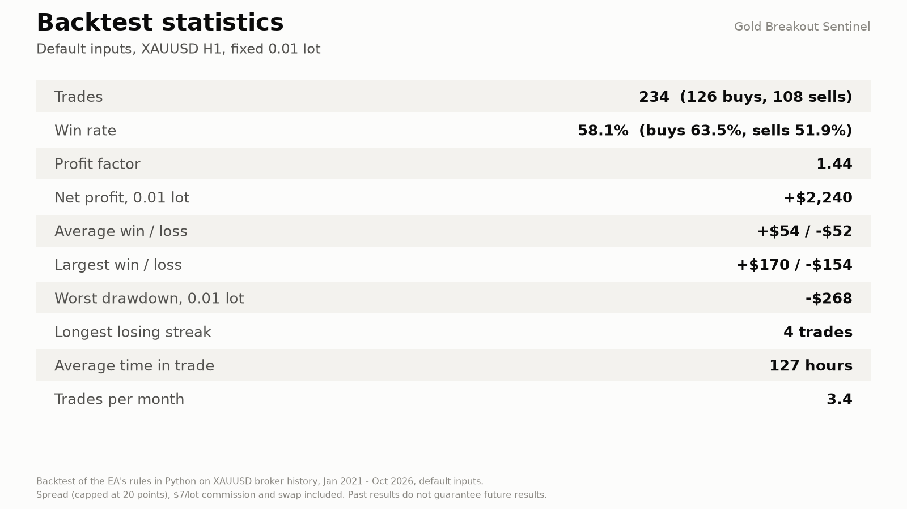
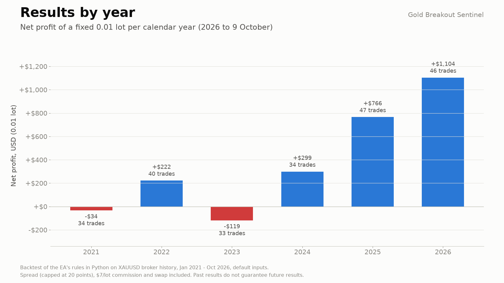
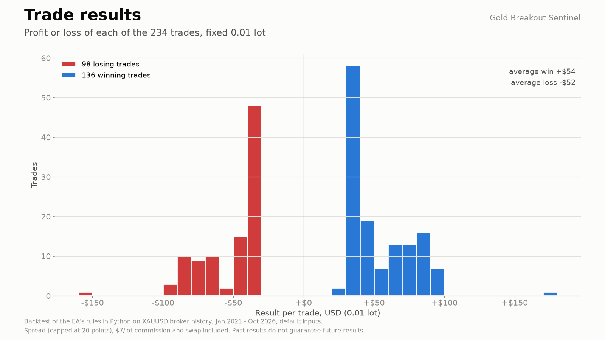
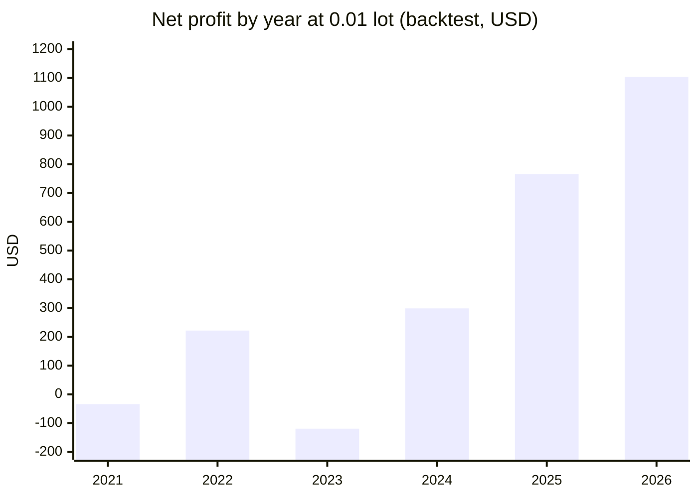
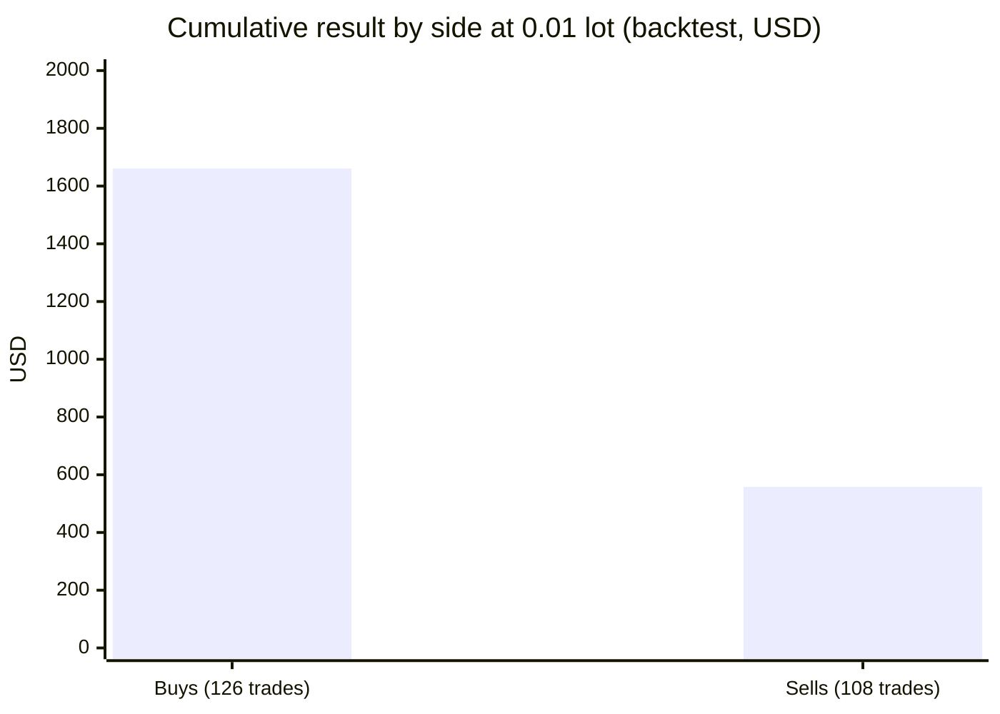
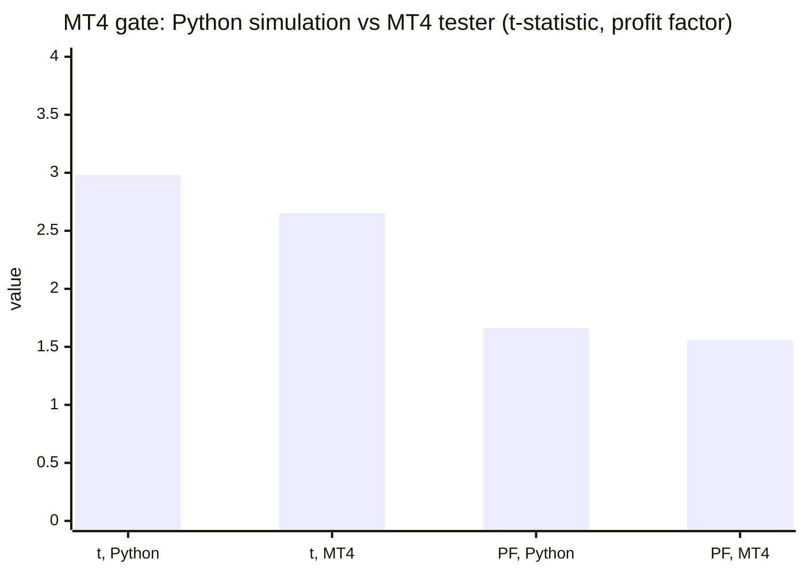

# Gold Breakout Sentinel (MetaTrader 5 and MetaTrader 4)

An Expert Advisor that trades **XAUUSD on the H1 chart**: it places pending stop orders at yesterday's high or low when a
stochastic turn and a Bollinger Band filter agree, with a fixed 0.01 lot and a fixed stop loss and take profit. It is a
rules-based daily breakout system, not a profit promise: **my own tests found no proven edge** (see
[Honest limits](#honest-limits)).

> **This is a showcase repository: documentation and images only. There is no source code here.** The product is distributed
> only through the MQL5 Market.

**Website:** [allanninal.dev/mql5/gold-breakout-sentinel](https://www.allanninal.dev/mql5/gold-breakout-sentinel/) · [MT4 editions](https://www.allanninal.dev/mql5/#mt4) · [allanninal.dev](https://www.allanninal.dev)
· **Contact:** message me on [LinkedIn](https://www.linkedin.com/in/allanninal/).

## Get it on the MQL5 Market

| Product | Platform | Price | Link |
|---|---|---|---|
| **Gold Breakout Sentinel** | MT5 | free | <https://www.mql5.com/en/market/product/200385> |
| **Gold Breakout Sentinel MT4** | MT4 | free | MT4 edition: coming soon on the MQL5 Market |
| Gold Breakout Sentinel Pro | MT5 | paid | <https://www.mql5.com/en/market/product/200903> |
| Gold Breakout Sentinel Pro MT4 | MT4 | paid | MT4 edition: coming soon on the MQL5 Market |

The free EA is standalone: you do not need to buy or install any other product. Details and the Strategy Tester demo are on the
Market pages. The paid edition has its own showcase repository:
[allanninal/gold-breakout-sentinel-pro](https://github.com/allanninal/gold-breakout-sentinel-pro).

## What it does

- **The EA trades gold only.** On any other live or demo chart it stays idle and says so on the panel; the Strategy Tester accepts any
  symbol. Prefixed or suffixed names (XAUUSDm, XAUUSD.pro) work.
- **The entry:** once per H1 bar it checks the stochastic signal line (closing prices). If it peaked on the previous bar and the
  Bollinger Band filter agrees, it places a **buy stop at yesterday's high**; if the line troughed, a **sell stop at yesterday's low**. The
  order is placed only while price has not passed that level, and a new signal on the same side replaces it.
- **The trade:** every order has a fixed 0.01 lot (or the broker's minimum where that is larger) and a stop loss and take profit of 1.9%
  of the entry price each. An unfilled order is deleted after 9 bars. No new order is placed while a position is open. No grid, no
  martingale, no averaging.
- **Yesterday** is the New York-close day on any broker; the EA detects the broker clock itself.
- **Safety checks:** before each order it checks margin, stop and freeze levels and the stop-out level. If the account cannot carry
  the order it skips it and shows the reason on the panel. At a gold price near 4,200 the stop on 0.01 lot loses about 80 USD; a
  balance of about 8,000 USD keeps the risk near 1% per trade, and smaller balances risk more (the Risk row says so).
- **On the chart:** an info panel (what the EA waits for, pending orders, the open trade, closed-trade results), yesterday's high and low
  drawn across today, and an arrow at each signal with its outcome in the tooltip. It has no indicator buffers and sends no alerts.

### Life of an order

| | |
|---|---|
|  |  |
|  |  |

More charts: [results by month](images/05-results-by-month.png), [buys and sells](images/09-buys-and-sells.png),
[when trades open](images/10-when-trades-open.png). They are drawn by a script from a Python reproduction of the rules on broker
history; they are illustrations, not terminal captures.

## Who it is for

Traders who want a transparent, rule-based gold breakout EA to run on a demo or small live account and watch. **Not** for anyone
looking for a proven or promised result, other symbols, or lot sizing by risk (that is the paid edition).

## Why it was built

- **To watch, not to sell an edge.** It is a simple daily breakout rule on gold that I wanted running as a transparent EA on a demo
  account first. It was never presented as proven.
- **Weak evidence, stated plainly.** The settings did well from 2021 and lost money over a longer history (below); on 36 other symbols
  the rules were not profitable, which is why the EA is limited to gold.
- **Honest, checkable behaviour.** The defaults are the settings used for every check; there is no set file.

## What the backtests show

Python reproduction of the rules (not a Strategy Tester run), XAUUSD H1 broker history, January 2021 to October 2026, default inputs,
fixed 0.01 lot, spread (capped at 20 points), USD 7 per lot commission and swap included. This was the most favourable period for these
settings.

| | |
|---|---|
| Trades | 234 (126 buys, 108 sells) |
| Win rate | 58.1% (buys 63.5%, sells 51.9%) |
| Profit factor | 1.44 |
| Net profit at 0.01 lot | +2,240 USD |
| Average win / loss | +54 / -52 USD |
| Largest win / loss | +170 / -154 USD |
| Worst drawdown at 0.01 lot | -268 USD |
| Longest losing streak | 4 trades |
| Average time in a trade | 127 hours; about 3.4 trades a month |

(2026 is to early October.) Source: the charts in [`images/`](images).

- **Over 2009 to 2020 the same settings lost money (profit factor 0.94).** The 2021 to 2026 years were the strategy's best period.
- **On 36 other symbols, 2023 to 2026, the rules were not profitable.**
- **Most of the result is recent:** 2025 and 2026 together are about 1,870 of the 2,240 USD.

## How it was checked

| Check | Result |
|---|---|
| Release check, version 1.16: MQL5 validation-style runs (EURUSD H1, XAUUSD D1, GBPUSD M30, EURUSD M1, small account) | no error lines |
| Non-repainting, XAUUSD H1, January to October 2026 | 400 signals, identical between every-tick and 1-minute OHLC models |
| MT4 publish gate, Python half: entries 2023-07-01 to 2026-09-30 (139 trades) | PASS: mean R +0.247, t 2.98, PF 1.66; halves +0.196 (PF 1.50) / +0.279 (PF 1.76) |
| MT4 publish gate, MT4 Strategy Tester half (every tick, two spread chunks of 170 then 20 points) | PASS: 142 trades vs 139, signals 1700 of 1703, mean R +0.216, t 2.65, PF 1.56, halves +0.115 / +0.283 |
| MT4 validator-style runs | 10 of 10 runs, 0 error lines |

The gate criteria were written before any number was computed: at least 40 trades; mean R > 0 and t >= 2.0; profit factor >= 1.20; both
halves positive; a news-pause run still positive. R is the profit divided by the risk at the stop. Stop-order fills in the MT4
tester depend on the spread, so trades were matched by side and fill within an hour (82% matched on entries, 95.7% on exits).
This is one test of one pre-existing setting with no search, so a pass means "not rejected on this window", and the listing claims no
profit. The MT5 edition was published before the gate existed; only the MT4 edition went through it.

These are code checks and backtests, not trading results.

## Honest limits

- **No proven edge.** The rules lost money over 2009 to 2020 and were not profitable on 36 other symbols; the good years are recent.
- **A Python reproduction is not a live record.** Spread, commission and swap are modelled; slippage on stop orders is a small fixed
  amount; real fills differ.
- **The stop is wide for a small account.** About 80 USD per 0.01 lot at a gold price near 4,200; about 8,000 USD keeps the risk near
  1% per trade.
- **Gold only,** on H1, with the defaults; other settings are not tested.
- On a hedging account both stop orders can fill on a day that breaks both levels.
- The source is not published; this repository documents what the product does and the results of its checks.

## Free vs paid

| | Gold Breakout Sentinel (free) | Gold Breakout Sentinel Pro (paid) |
|---|---|---|
| The entry rule and the fixed stop and target | yes | yes |
| Lot | fixed 0.01 (or the broker minimum) | risk levels or a fixed lot |
| Account protection, news, time and spread filters, trade management, panel buttons, alerts | no | yes |
| MT5 | [200385](https://www.mql5.com/en/market/product/200385) | [200903](https://www.mql5.com/en/market/product/200903) |
| MT4 | coming soon | coming soon |

---

**Website:** [allanninal.dev/mql5/gold-breakout-sentinel](https://www.allanninal.dev/mql5/gold-breakout-sentinel/) · [MT4](https://www.allanninal.dev/mql5/#mt4) · [allanninal.dev](https://www.allanninal.dev)
· Questions: message me on [LinkedIn](https://www.linkedin.com/in/allanninal/). All rights reserved, see [LICENSE](LICENSE).
